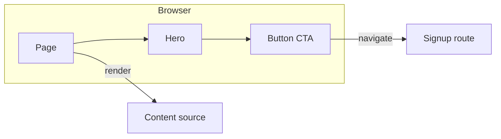
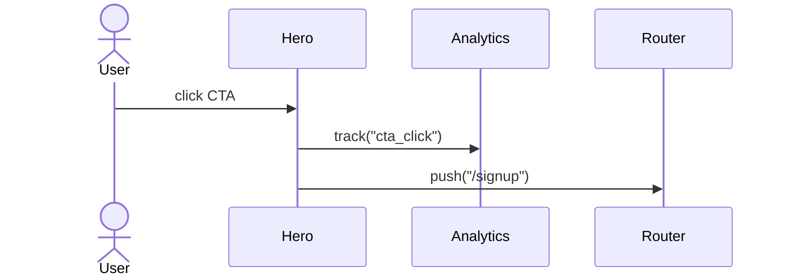
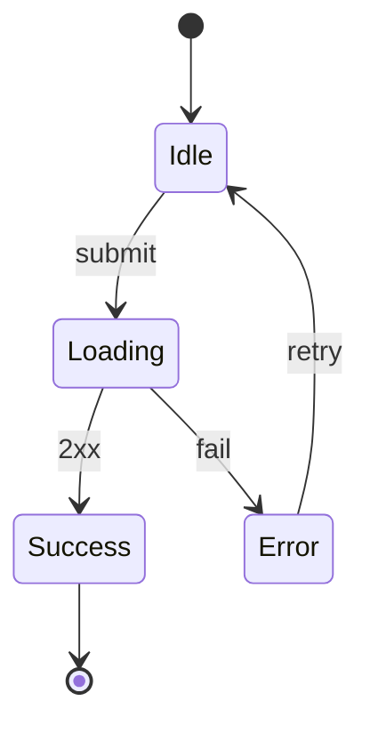

# How to create graphs & diagrams (expert)

A diagram answers **one question**. If it needs a paragraph to explain the diagram, simplify the diagram.

## Choose the form

| Need | Form |
|------|------|
| Compare options / metrics | Markdown table |
| Structure, ownership, deps | Mermaid flowchart / C4-ish boxes |
| Runtime interactions | Mermaid sequence |
| Modes / lifecycle | Mermaid state |
| Data model | Mermaid ER / class |
| Interactive exploration | Canvas / HTML viz (when available) |

Prefer Mermaid in-repo and in chat — portable, reviewable, diffable.

## Rules of clarity

1. **One question** in the title/caption (“How does CTA click reach analytics?”).
2. **5–12 nodes** for overview; link to a second diagram for detail.
3. **Label edges** with verbs/events (`submits`, `fetches`, `emits`).
4. **Show boundaries** (browser / server / third-party) with subgraphs.
5. **No decoration** — colors only for meaning (error path, trust boundary).
6. **Match code names** — ubiquitous language; don’t invent synonyms.

## Templates

### System / component context

### Sequence (runtime)

### State

### Decision / tradeoff (table > graph)

| Option | Pros | Cons | Reversal cost |
|--------|------|------|---------------|
| A | … | … | Low |
| B | … | … | High |

## C4 lite (when systems grow)

- **Context**: people + systems
- **Container**: apps, DBs, queues
- **Component**: modules inside one container
- Don’t jump to code diagrams until containers are clear

## When to add a diagram to the PR / plan

- New module boundaries
- Non-obvious data/control flow
- Migration / strangler steps
- Onboarding a complex feature

Skip diagrams for trivial renames and single-component copy tweaks.

## Anti-patterns

- Kitchen-sink architecture posters
- Diagrams that disagree with the code (update or delete)
- UML ceremony for a landing page section
- Screenshots of whiteboards as the only source of truth
