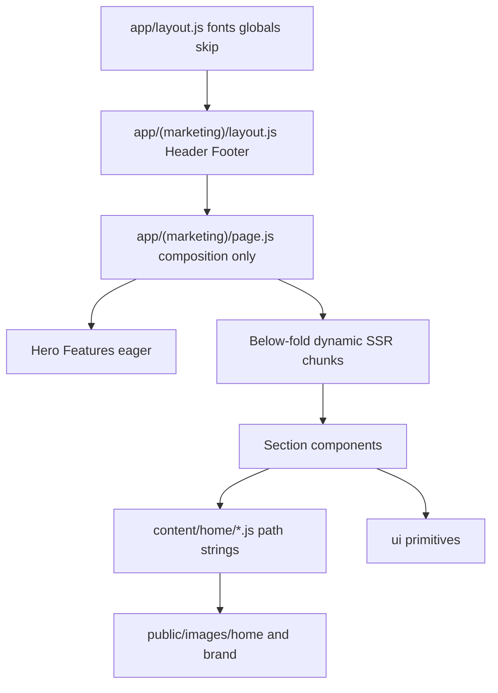

# Architecture

AuthorBot marketing site — high-quality App Router seams for performance and multi-page scale.



## Seams

| Seam | Owns | Must not own |
|------|------|--------------|
| `app/layout.js` | Fonts, globals, skip link, metadata shell | Header, Footer, page images, sections |
| `app/(marketing)/layout.js` | Marketing chrome (Header/Footer) | Page-specific section trees |
| `app/(marketing)/page.js` | Section composition + dynamic imports | Content barrels, image binaries |
| `content/home/*` | Copy + **path strings** to media | Layout, CSS, React state |
| `content/media.js` | `MEDIA_BASE` + brand/home path helpers | UI components |
| `public/images/**` | Optimized static media | Application logic |
| `Section/*` | Own content module + presentation | Cross-page content imports |
| `ui/*` | Dumb primitives | Business copy |
| `ScrollReveal` | Entrance observation | Product decisions |

## Multi-page rules (20+ pages)

1. One content folder per route: `src/content/<page>/`
2. Page files compose sections only; never import another page’s content barrel
3. Put shared chrome in a route-group layout, not the root layout
4. Use `dynamicSection()` from `@/lib/dynamicSection` for below-fold / heavy sections
5. Store page media under `public/images/<page>/`; reference via path strings
6. To adopt a CDN later, set `MEDIA_BASE` in `src/content/media.js` (and Next `images.remotePatterns` if needed)

## Adding a marketing page

```text
src/app/(marketing)/about/page.js
src/content/about/*.js
public/images/about/*
```

## Quality gate

```bash
npm run check
npm audit --audit-level=high
```
